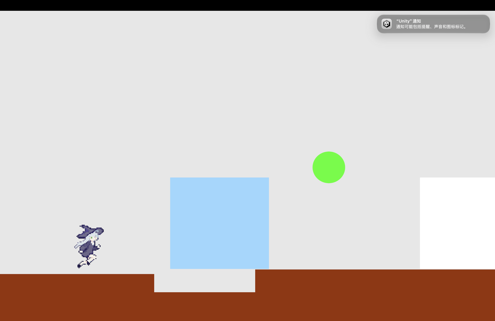

# 重力翻转平台跳跃（Unity 2022）

一个 2D 重力翻转平台跳跃小游戏：主角可以切换重力方向（上 / 下 / 左 / 右），在四个表面上行走、跳跃；支持键盘和 PS5（DualSense）手柄。



## 环境要求

- Unity **2022.3.62f3c1**（用 Unity Hub 安装这个版本）
- 手柄功能仅支持 macOS（PS5 DualSense）；Windows / Linux 直接用键盘鼠标
- 不需要把 Unity 引擎放进仓库：引擎由每个人本地安装，仓库里只有项目源码和配置

## 打开与运行

1. 打开 Unity Hub，点击 **Add**，选择本项目文件夹
2. 用 Unity 2022.3.62f3c1 打开项目
3. 打开场景 `Assets/Scenes/Main.unity`
4. 点 **Play**

## 操作说明

### 键盘

| 按键 | 作用 |
| --- | --- |
| A / D | 左右移动；贴左/右墙时也可以沿墙上下移动 |
| W / S | 贴左/右墙时沿墙上下移动（与 A/D 等效） |
| 空格 | 跳跃 |
| R | 进入 / 退出重力方向选择 |
| 方向键 | 选择重力方向（上 / 下 / 左 / 右） |
| 鼠标 | 移动绿色圆圈；悬停方块上时方块变浅蓝，按方向键给方块设置重力方向 |

### PS5 手柄（macOS）

| 按键 | 作用 |
| --- | --- |
| 左摇杆 | 移动；贴墙时左摇杆的左右/上下都能沿墙移动 |
| × | 跳跃 |
| △ | 进入 / 退出重力方向选择，之后用十字键选方向 |
| 按住 L2 | 光标模式：主角停止移动 |
| L2 + 左摇杆 | 拖动绿色圆圈 |
| 光标模式下按 × | 确认选中方块（保持浅蓝） |
| 十字键 | 选中方块后：给方块设置重力方向并结束选中 |

## 目录结构

```
Assets/
  Scenes/Main.unity        主场景
  c#/                      游戏脚本
  ass/                     图片素材
  Editor/PadBridgeBuild.cs 打包后处理（把 macOS 手柄桥接复制进 App）
PadBridge/
  gamepadbridge.swift      PS5 手柄桥接源码（macOS，Swift + GameController）
  gamepadbridge            编译后的可执行文件（未提交，需自行编译）
Packages/                  依赖清单
ProjectSettings/           工程设置
```

## PS5 手柄桥接（macOS）

Unity 的 Input System 在 macOS 上解析 DualSense 的按键不可靠，所以本项目用 Swift + GameController 框架实现了一个小工具来读取手柄。

`PadBridge/gamepadbridge` 是编译产物，**没有提交到仓库**，需要自己生成：

```bash
cd PadBridge
swiftc -O gamepadbridge.swift -o gamepadbridge
```

- 需要 Xcode 命令行工具（`xcode-select --install`）
- 编辑器运行时：`PadBridge.cs` 会直接启动它
- 打包 macOS App 时：`Assets/Editor/PadBridgeBuild.cs` 会自动把它复制进 App 的 `Contents/Resources/Data/StreamingAssets/` 并 `chmod +x`
- 没有手柄或不在 macOS：游戏自动使用键盘鼠标

## 打包（macOS）

1. Unity 菜单 **File → Build Settings**
2. Platform 选 **macOS**，把 `Scenes/Main` 加入 **Scenes In Build**
3. 点 **Build**，选择输出目录
4. 首次打开未签名的 `.app`：右键 → 打开（或 `xattr -dr com.apple.quarantine "xxx.app"`）

构建产物在 `Builds/` 目录，已被 `.gitignore` 忽略。

## 仓库不包含的内容

- Unity 引擎 / 编辑器（需自行通过 Unity Hub 安装 2022.3.62f3c1）
- `Library/`、`Temp/`、`Logs/`、`UserSettings/`、`Builds/` 等本地缓存与构建产物
- 编译好的 `PadBridge/gamepadbridge` 可执行文件（按上面的命令生成）
- 当前仓库源码约 1.2 MB，克隆、Fork 都很轻量

## 贡献

欢迎 Fork、提 PR。提交前请确认没有把 `Library/`、`Builds/` 等加入仓库，`.gitignore` 已经配置好。

## License

未指定；如需开源协议可自行添加（例如 MIT）。
